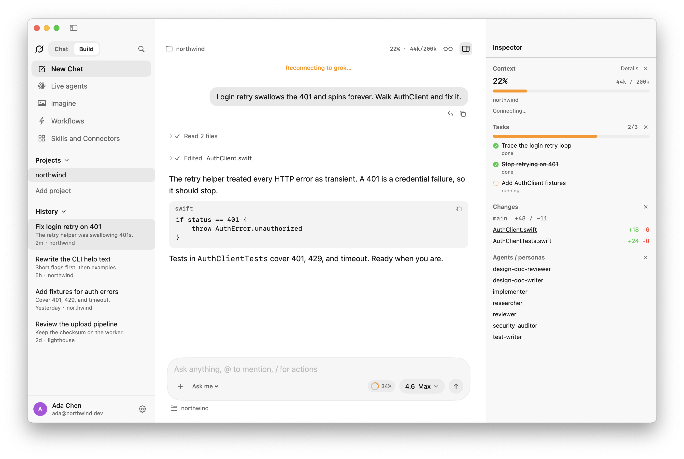

# Grok Desktop


[](https://github.com/wolfqing/GrokDesktop/releases/latest)
[](https://github.com/wolfqing/GrokDesktop)
[](https://www.swift.org)
[](https://developer.apple.com/xcode/swiftui/)
[](https://agentclientprotocol.com)
[](LICENSE)

A native macOS SwiftUI client for [Grok](https://grok.com/) and [Grok Build](https://x.ai/build).

- **Chat** embeds grok.com in the window.
- **Build** talks to your local `grok` CLI over ACP. Sessions, skills, Imagine, and config stay in `~/.grok`.

This entire app was built with [Grok Build](https://x.ai/build) on Grok 4.6.

Community project. Not an official xAI / SpaceXAI product.



## Install

**Download:** [Grok-Desktop-0.1.33.zip](https://github.com/wolfqing/GrokDesktop/releases/download/v0.1.33/Grok-Desktop-0.1.33.zip) · [All releases](https://github.com/wolfqing/GrokDesktop/releases) · [Changelog](CHANGELOG.md)

**From 0.1.32.** When a turn finishes, the conversation stays on the reply. Folding the tool rows no longer leaves a blank page.

**From 0.1.31.** Speak a draft, and a saved bridge can take new messages while the app is open.

- The composer and the small Desk window have a microphone. What you say fills the draft. Stopping leaves the sentence in the box.
- Start live on the bridges you already saved. Telegram, Discord, Matrix, Slack, QQ, DingTalk, Weibo, and Messages deliver new inbound text into a trusted project. Personal WeChat stays paste-only. Feishu checks the credential, then you still paste. LINE and WeCom can take a local callback. Older messages stay out.
- The phone page shows an address on this Mac, or one on the same network. A Cloudflare quick-tunnel address is read from the tunnel log.
- The main window is centered once. Opening a file preview no longer changes the sidebar width in the same click.

**From 0.1.30.** Sessions, trusted folders, a phone mirror, message bridges, and a remote host. The Dock and Finder icon is the Grok mark.

- A follow-up can wait, or steer the turn that is running. A session can attach files, fork, and keep up to three earlier sessions in view. Search, rename, archive, and delete stay on this Mac. Session files can stay in `~/.grok` or live in an app folder. The two stores are not merged.
- A new folder starts untrusted. An untrusted folder cannot receive agent writes. Removing it from the sidebar leaves the folder on disk. Switching a worktree moves that session's folder.
- A diff can be accepted, rejected, or reverted one file at a time or as a batch. Text files edit in place. Images, video, audio, PDF, and Office files preview when the path is inside a trusted project.
- Ask is the default. Allow once, allow for the session, or deny. Always-approve is optional, and it can be set per project.
- A saved bridge turns inbound text into a turn only for a project you already trust. `/p` starts a session there. `/r` resumes one that already exists. The app does not sign in to those networks.
- The phone mirror listens on this Mac. It lists sessions and continues one you already have. A busy session queues the text. The token is not shown in the window. Keep it on this Mac, open it on the local network, or start a Cloudflare quick tunnel.
- A remote session uses the OpenSSH already on this Mac. The agent runs on the remote host. Remote files, the remote terminal, and remote skills stay on that host.
- One session can watch several pull requests. A new comment, a review, a failing check, or a green check is queued as a follow-up when `gh` can read them.
- More than one account can sign in. The API key stays in the keychain. Logs and the diagnostic export leave secrets out. A custom relay can use its own Grok home, or share `~/.grok` without rewriting the other copy.
- MCP servers, plugins, skills, agents, and hooks can be turned off. A note you schedule runs on its own and keeps a log.
- A small window can stay above other windows. From there you can dictate, send, and stop.
- The first launch looks for `grok` and accepts a path you pick. A missing CLI, a sign-in problem, a network problem, and an agent crash stay separate.
- An HTTP or SOCKS proxy is passed through. The sandbox can be off or restricted.
- With no language chosen, the shell follows the system language. You can pick English, Simplified or Traditional Chinese, Japanese, Korean, German, French, Russian, Spanish, Brazilian Portuguese, Italian, Indonesian, Tamil, Ukrainian, Filipino, or Turkish. Chat and Build stay those words.

1. macOS 14+
2. Unzip and move `Grok Desktop.app` to Applications
3. Official Grok Build CLI
4. A grok.com account (`grok login`) or `XAI_API_KEY`

```bash
curl -fsSL https://x.ai/cli/install.sh | bash
grok login
```

Grok Desktop does **not** ship the `grok` binary. It looks on `PATH`, then `~/.local/bin/grok`, `~/.grok/bin/grok`, `/opt/homebrew/bin/grok`, and `/usr/local/bin/grok`.

The zip is unsigned unless a release says otherwise. First open: right-click the app → Open.

After it is in Applications, the app checks GitHub on launch and every 4 hours. A newer release downloads in the background and installs the next time you open it. Move the app out of the zip or disk image first; a copy opened from there cannot replace itself.

If it won't install, won't open, or you want a feature: [open an issue](https://github.com/wolfqing/GrokDesktop/issues/new/choose).

**Chat** can sign in on grok.com inside the app. **Build** needs the CLI (and `grok login` or an API key). Signing in from the app WebView can cover both when you use a grok.com account.

## Layout

- Sidebar switch: **Chat** | **Build** (`⌘1` / `⌘2`)
- **Chat**: grok.com. History stays on the web, not mixed with Build sessions.
- **Build left**: new session, search, Imagine, live agents, history grouped by project folder from `~/.grok/sessions` (Codex / Claude style). Opening a past chat shows right away; long sessions load in the background. Adding a named project keeps the folders already inferred from sessions.
- **Imagine**: local image and short video through the grok agent (`/imagine`, `/imagine-video`). Recents come from session `images/` folders. This is not grok.com/imagine inside Chat.
- **Build center**: conversation, Markdown, clickable files/links. Thinking and tool rows follow the Grok Build TUI. A sent prompt shows up right away, with `Received — thinking…` until grok answers. Drag-select copies. Scroll away and a down arrow jumps back to the latest message. The latest prompt can be put back in the composer.
- **Build inspector**: context, tasks, plan, diffs, live terminals, and this-turn status. `/btw` / ⌘⇧B opens a Codex-style aside composer; side questions stay out of the main thread.
- **Settings**: account, appearance, behavior, extensions, grok CLI updates — reads `~/.grok/config.toml`

## Build from source

Command Line Tools are enough. Xcode.app is not required.

```bash
swift build -c release
./scripts/bundle.sh
open "dist/Grok Desktop.app"
```

```bash
swift run GrokDesktop
swift run GrokDesktopSmoke
```

There is no XCTest target. Smoke lives in `GrokDesktopSmoke`.

Release zip (unsigned unless you have a Developer ID):

```bash
./scripts/release.sh
./scripts/release.sh --publish   # GitHub release
```

To notarize, set `SIGN_IDENTITY` to a Developer ID Application identity and `NOTARY_PROFILE` to a stored notarytool profile, then run `./scripts/release.sh --publish`.

## License

Apache-2.0. See [LICENSE](LICENSE).

Grok, Grok Build, and grok.com are trademarks of their owners.
